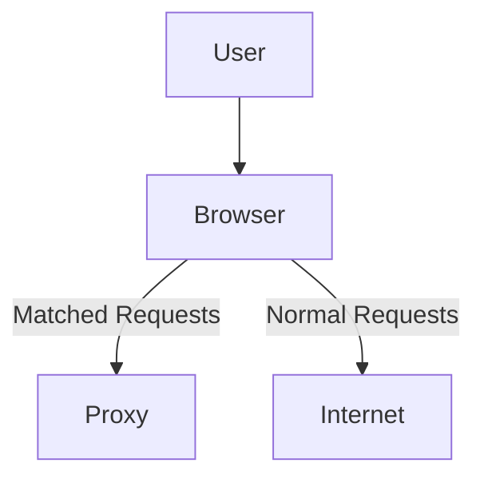
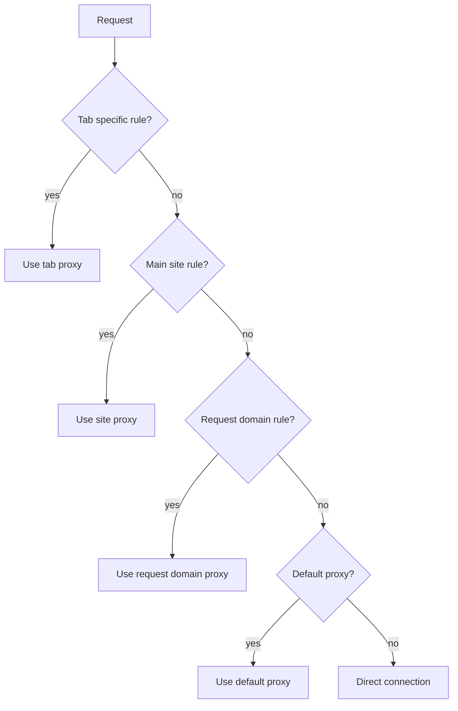

# GeoBypass

GeoBypass is a browser extension that manages a list of proxies and routes browser traffic through them by request rule. Traffic that matches no rule connects directly.



## Features

- Proxy list, with a per-tab and per-site proxy assignment from the popup
- Domain-based overrides, which assign a proxy to a website
- Rules that match requests by URL pattern, with bypass and force patterns
- Optional keep-alive monitors for proxies
- Network monitoring for a tab, turned on from the popup and read as a request log in the dashboard under Network
- Import and export of rules, proxies, keep-alive monitors, and settings, with a review step before anything is written

## Browser differences

Firefox and Chrome share the dashboard, the popup layout, and the rule engine. They differ in what the browser lets the extension control.

| Capability | Firefox | Chrome and Chromium |
| --- | --- | --- |
| Proxy per tab | Yes, from the popup ("This tab") | No, the popup offers "This site" only |
| Proxy per website (override) | Yes | Yes |
| Test proxy from the popup | Yes | No, use the Test section of the dashboard |
| Warning when another extension controls proxy settings | Not shown | Shown in the popup |

On Chrome, a site proxy covers requests to the site and its subdomains. It does not cover other hosts the page loads from. The popup states this where the choice is made.

## Popup

The popup is for the tab you are looking at.

- **This tab** shows the active tab's domain, the proxy in effect for it, and the proxy select with an "Apply to" choice (This tab on Firefox, This site on both browsers).
- **Set** applies the selected proxy to the chosen scope. **Clear** removes the override for that scope.
- **Test proxy** runs a short connectivity test on the selected proxy (Firefox only).
- **Monitor this tab** starts network monitoring for the tab. Monitoring runs only while it is on.
- **Rules** lists the rules, with a switch to turn each one on or off.
- **Dashboard** opens the full settings page.

## Dashboard

The dashboard opens from the popup or the browser's extension page. It has these sections:

- **Home** shows the quick actions for adding rules and proxies and for importing.
- **Proxies** holds the proxy list and the default proxy.
- **Rules** holds the matching rules.
- **Sites** holds the domain overrides.
- **Keep-alive** holds the keep-alive monitors.
- **Defaults** holds the fallback to direct connection and the test URL.
- **Test** runs a connectivity test on a saved or custom proxy.
- **Network** shows the request log for monitored tabs, grouped by host, refreshed automatically.
- **Import and export** imports and exports the configuration.
- **About** shows the version and the project links.

## Importing

Each import section (Proxies, Rules, Sites, Keep-alive, and Import and export) takes a file. Import and export also takes a raw `.json` URL or a GitHub repository, and pressing Enter in its URL field runs the import. The community repository [GeoBypass-Rules](https://github.com/MeGaNeKoS/GeoBypass-Rules) is offered as a source, and it holds rules and keep-alive monitors for known websites.

Every import opens a review sheet before anything is written.

- **To add** lists the items that are new.
- **Needs your attention** lists items that were refused or ignored, with the reason.
- **Already in your list** lists each duplicate with its resolution: Keep existing, Use new, or Keep both.
- **Settings in this file** lists each setting the file changes, with the current value and the imported value. Each one is either Keep current or Use imported.

Import runs only when you press **Import** in the sheet. Closing the sheet writes nothing.

## Rule hierarchy

Proxy selection follows these rules:

1. **Tab specific rule**: If a tab is assigned a proxy, it takes priority. **All network requests** from that tab are proxied. Firefox only.
2. **Main site rule**: If the tab URL's domain matches a configured override, the proxy from that override is used. **All network requests** from that tab are proxied. Firefox and Chrome.
3. **Request domain rule**: If the request URL matches an existing rule, **only those specific requests** are proxied.
4. **Default proxy**: Used when no other rule matches.
5. **Direct connection**: Used when no proxy rules apply.



## Building

Install dependencies, then build a development version for one browser:

```bash
npm install
npm run build:dev:firefox
npm run build:dev:chrome
```

Production builds minify the output:

```bash
npm run build:prod:firefox
npm run build:prod:chrome
```

`npm run package:dev:firefox`, `npm run package:prod:firefox`, and the matching Chrome scripts produce the packaged archives. See `package.json` for the full list.

The builds write to `dist/`, which both browsers share. Build the browser you are about to load.

## Testing

Unit tests and the type check:

```bash
npm test
```

Smoke tests drive an installed browser against a built extension. They use the browser's default install path, and `SMOKE_CHROME_PATH` or `SMOKE_FIREFOX_PATH` overrides it. The scripts build the browser's development version first.

```bash
npm run smoke:chrome
npm run smoke:firefox
```

## Requirements

* Node.js 18 or newer
* npm

---

## Browser support

* **Firefox**: [Add-on page](https://addons.mozilla.org/en-US/firefox/addon/geobypass/)
* **Chrome**: [Add-on page](https://chromewebstore.google.com/detail/geobypass/ihocglepfddiancfooeablkngmckkjdm/)

---
